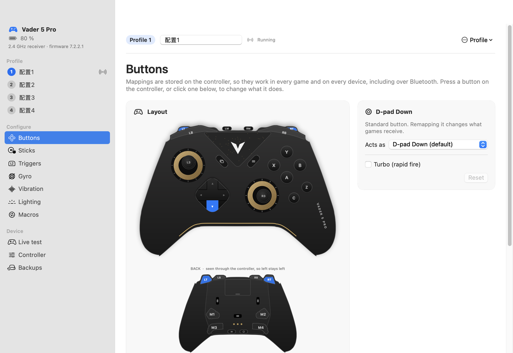
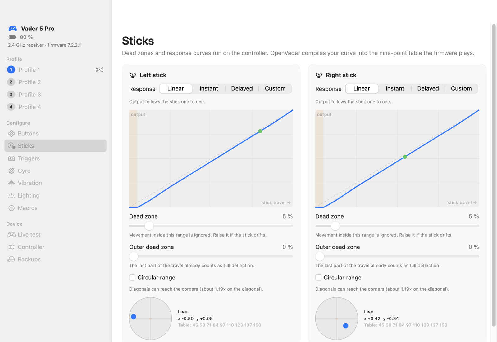
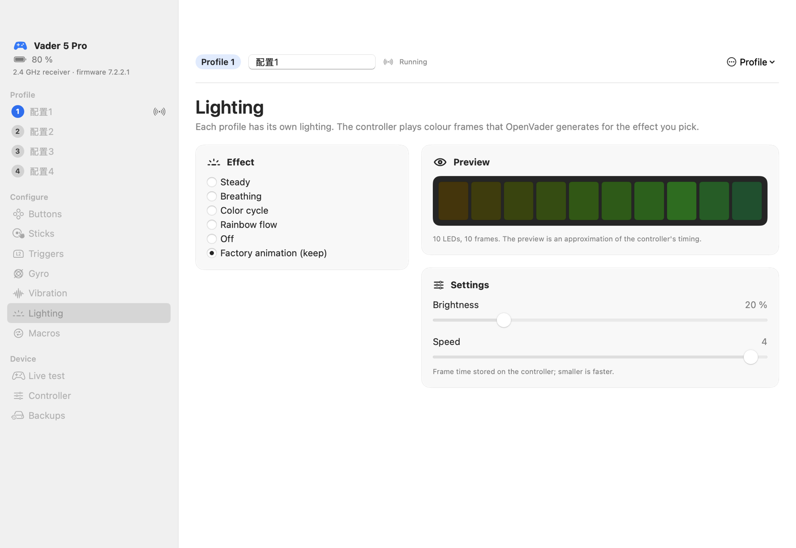
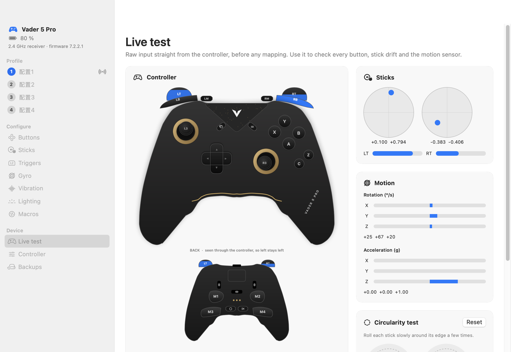

# OpenVader

[](https://github.com/FilipVajgand/openvader/actions/workflows/tests.yml)

A native, open-source macOS app for configuring the **Flydigi Vader 5 Pro**: remap the back paddles and
extra buttons, tune stick dead zones and response curves, shorten trigger travel, set up on-controller gyro
aiming, adjust rumble, design the lighting, record macros and manage the four on-board profiles, all
without Windows.



| Sticks | Lighting | Live test |
|---|---|---|
|  |  |  |

> Unofficial. Not affiliated with or endorsed by Flydigi. The protocol was reverse-engineered by the
> community (see [Credits](#credits)). Use at your own risk; OpenVader backs up the controller every
> time it connects.

## Why

Flydigi's configuration software, Space Station, only runs on Windows. When this was written (October
2026), the Mac options were:

| Project | What it does on a Mac |
|---|---|
| [dracinn/ControlLab](https://github.com/dracinn/ControlLab) | Live input, firmware reads and updates, steady-colour lighting. Writing profiles is deliberately disabled. |
| [uiltonlopes/flydigi-space-station-mac](https://github.com/uiltonlopes/flydigi-space-station-mac) | A full Space Station replacement for the **Apex 4**; Vader 5 Pro support is at the probe stage. |
| [Sisyphu5s/flydigi-back-buttons-macos-bridge](https://github.com/Sisyphu5s/flydigi-back-buttons-macos-bridge) | A hardware bridge on an RP2350 board. |

Nothing could change what is stored on a Vader 5 Pro from macOS. OpenVader fills that gap. Settings
live on the controller, so they keep working everywhere afterwards: over Bluetooth, on a Mac, an iPad,
a Switch or a PC.

## What you can do

| Area | What it changes | Where it runs |
|---|---|---|
| **Profiles** | Four on-board slots: switch, rename, copy between slots, reset to factory, back up, restore, a profile library and `.ovprofile` files, copy one into Nintendo Switch mode | controller + Mac |
| **Buttons** | Remap M1–M4, LM/RM, C/Z and every standard button to any Xbox-layout button; per-button turbo (1–20/s, hold or toggle) | controller |
| **Sticks** | Linear / instant / delayed / custom curve, inner and outer dead zone, circular or square range | controller |
| **Triggers** | Physical travel window (hair trigger), trigger-motor vibration strength | controller |
| **Gyro** | Motion to left or right stick, activation key (hold or toggle), sensitivity, dead zone | controller |
| **Vibration** | Grip motor on/off, intensity window and gain per side; test all four motors | controller |
| **Lighting** | Steady, breathing, strobe, colour cycle, rainbow fade, rainbow flow (left or right), comet, scanner, fire or off; colours, brightness, speed | controller |
| **Macros** | Up to 10 per profile, recorded live from the controller or edited step by step; a macro library and copying between profiles | controller |
| **Controller** | Name, sleep timer, stick precision and centre sensitivity, quick profile switching, turbo, stick debounce/auto-calibration/snap-back filter, Steam & SDL takeover, firmware update check | controller |
| **Keyboard & mouse** | Buttons as keys, clicks or scrolling; sticks as pointer, WASD, arrows or scrolling; gyro as pointer (what Space Station does on Windows) | Mac, while OpenVader runs |
| **Live test** | Every button, both sticks, triggers, gyro and accelerometer at ~500 Hz; stick circularity test | Mac |

### Tips for Mac players

- **Bluetooth is for playing, the receiver is for configuring.** Over Bluetooth the Vader 5 Pro pairs as
  "Xbox Wireless Controller", an Xbox One S controller to the system, but the paddles have no Xbox equivalent.
  Map them to real buttons in OpenVader and they work over Bluetooth too.
- **Gyro aiming runs on the controller.** Map it to the right stick, hold LT to aim, and it works in any
  game with nothing running on the Mac.
- **Steam and SDL 3 games over the receiver.** macOS has no driver for the receiver's Xbox 360-style
  interface. Turn on *Controller → Allow apps to take over the controller* (firmware 7.1.4.1 or newer) and
  Steam and SDL 3 games read the controller directly, paddles and gyro included.

## Install

Requires macOS 14 or newer and the Xcode command-line tools (Swift 6).

```sh
git clone https://github.com/FilipVajgand/openvader.git && cd openvader
scripts/build-app.sh            # builds build/OpenVader.app and build/vaderctl
open build/OpenVader.app
```

Plug in the 2.4 GHz receiver (or a USB-C cable), switch the controller on, and OpenVader connects by
itself. No drivers, no root, no special entitlements: the configuration interface is a vendor HID device
that any app may open.

Try the interface without a controller:

```sh
build/OpenVader.app/Contents/MacOS/OpenVader --demo
```

### Command line

`vaderctl` does everything the app does, which is handy for scripting:

```sh
build/vaderctl info                       # model, battery, firmware, settings
build/vaderctl profiles                   # what each profile holds
build/vaderctl backup                     # to ~/Library/Application Support/OpenVader/Backups
build/vaderctl remap 1 m1 a               # profile 1: M1 acts as A
build/vaderctl remap 1 rt default turbo 15
build/vaderctl stick 1 right deadzone=8 curve=delayed circular=on
build/vaderctl trigger 1 right 0 60       # hair trigger
build/vaderctl gyro 1 right key=lt hold sensitivity=40
build/vaderctl light 1 breathing '#00A0FF' '#FF0060' brightness=60
build/vaderctl monitor 10                 # live input for 10 seconds
build/vaderctl help
```

Set `OPENVADER_TRACE=1` to print every packet.

## Safety

- **Automatic backups.** All four profiles (mapping, lighting and macros) are saved every time the
  controller connects; the newest 20 are kept. *Backups → Restore* puts any of them back, and takes
  a fresh backup first.
- **Every write is read back** and compared byte for byte before OpenVader reports success.
- **Unknown layouts are read-only.** The profile announces its own layout version; OpenVader only writes
  layout 3.2, the one this was built against.
- **Dangerous commands are blocked in the transport**, whatever calls it: firmware-upgrade mode (`0x1F`),
  the "reset one profile" command that actually resets all four (`0xAF`), full factory reset (`0xFD`) and
  device-identity writes (`0xFE`).
- **No firmware flashing.** Update firmware with Flydigi's tools.

## How it works

The controller exposes a vendor HID interface (usage page `0xFFA0`) that takes 32-byte frames:

```
5A A5 <command> <length = 2 + payload> <payload…> <checksum = sum(command … payload) & 0xFF>
```

Profiles are moved as 20-byte packets: an 840-byte mapping blob, a 320-byte lighting blob (10 LEDs ×
10 frames) and a 1660-byte macro store per profile. Two things the firmware does not do are done by
OpenVader: it compiles stick curves into the nine-point table the controller plays, and it renders
lighting effects into colour frames. The details, with every quirk that matters, are in
[docs/PROTOCOL.md](docs/PROTOCOL.md).

```
Sources/
  VaderKit/     protocol, IOKit transport, profile/lighting/macro codecs, emulator
  vaderctl/     command-line tool
  OpenVader/    SwiftUI app
Tests/          codec tests and end-to-end tests against the emulator
```

```sh
swift test      # no controller needed
```

## Troubleshooting

- **"Allow accessory to connect?" flashes up and disappears.** The controller reconnects a few times
  while it powers on, which withdraws the prompt before you can click it. In *System Settings → Privacy &
  Security → Allow accessories to connect*, choose *Automatically when unlocked*, plug the controller in,
  then switch the setting back if you like; approved accessories are remembered.
- **Nothing shows up.** Switch the controller on, use a data cable rather than a charge-only one, and
  plug straight into the Mac. `build/vaderctl list` shows what macOS can see.
- **Bluetooth.** Fine for playing, but the configuration interface is only reachable over the receiver
  or a cable.
- **Phone games ignore the controller.** If the light flashes cyan while pairing, the controller is in
  Flashplay mode, where a phone sees a touchscreen instead of a gamepad. Press Fn (the ○ button on the
  back) + D-pad Right; the light turns orange. Then pair "Xbox Wireless Controller". See
  [docs/BLUETOOTH.md](docs/BLUETOOTH.md).

## Status

Tested on a Vader 5 Pro, firmware 7.1.5.0, over USB cable on macOS 26, by reading both the controller's
raw input and what it sends to games:

| Feature | On hardware |
|---|---|
| Reading, backup, byte-exact restore, factory data | verified |
| Button remapping (M1 → A) | verified: games receive A |
| Turbo (10 presses per second) | verified |
| Stick dead zone and response curve | verified |
| Gyro to stick, hold-to-activate | verified |
| Macros (stored and played by the controller) | verified: M2 plays X then Y |
| Lighting: every effect, rainbow direction, speed levels | verified by eye: the controller fades between frames |
| Mac keyboard/mouse markers: a button or stick handed to the Mac is hidden from games while OpenVader still reads it | verified |
| Mac keyboard/mouse output: a paddle typing a key, gyro moving the pointer | verified (needs Accessibility access) |
| Motor test: trigger motors | verified: both triggers buzz over the cable |
| Bluetooth on a Mac: games see an Xbox One controller; grip rumble | verified |
| Bluetooth on a Mac: trigger rumble from games | does not reach the trigger motors |
| Trigger travel window (travel mode of the trigger switch) | verified: the pull between start and end is stretched over the full range, a hair trigger |
| Grip rumble on/off per motor | verified: a switched-off motor stays still under game rumble |
| Stick precision | verified: at 8 bit, games receive 256-step values |
| Centre sensitivity | written and read back; no clear effect measured yet |
| Grip rumble strength window and gain, Switch-mode copy | written through the same verified paths; effect not yet checked |

If something does not behave the way OpenVader says it will, please open an issue with the output of
`OPENVADER_TRACE=1 build/vaderctl …` and your firmware version.

The controller drawing is schematic. It does not use Flydigi's artwork.

## Credits

OpenVader is a clean implementation for interoperability. It stands on documentation and measurements
published by:

- [flydigi-vader-pro-5-ctl](https://github.com/rR6kULhc5xgS/flydigi-vader-pro-5-ctl) (MIT): the Vader 5
  Pro protocol documents, mapping and macro layouts, and the list of commands never to send.
- [OpenFlydigi](https://github.com/mkaliaha/openflydigi) (MIT, protocol notes CC0): hardware measurements
  of the profile blob, the stick-curve compiler OpenVader ports, and the lighting-frame findings.
- [SDL](https://github.com/libsdl-org/SDL) `SDL_hidapi_flydigi.c` (zlib): the handshake, the report-ID rule
  for the Vader 5 Pro and the minimum firmware for third-party takeover.
- [Tux InVader](https://github.com/TJLawInOrbit/tux-invader), [ControlLab](https://github.com/dracinn/ControlLab)
  and [Space Station for Mac](https://github.com/uiltonlopes/flydigi-space-station-mac): protocol facts
  confirmed on hardware (no code was copied from these copyleft projects).

## License

MIT, see [LICENSE](LICENSE). "Flydigi" and "Vader" are trademarks of their respective owners.
